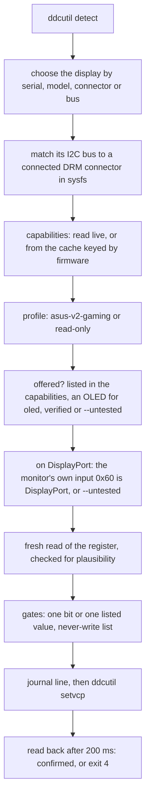

# osdless

[](https://github.com/ovflowd/osdless/actions/workflows/ci.yml)
[](LICENSE)

Change ASUS gaming monitor settings from Linux without the OSD: OLED care, power, KVM and inputs
over DDC/CI, with checked writes on top of ddcutil.

ASUS monitors keep their OLED care, power, KVM and input settings in manufacturer-specific DDC/CI
registers. ASUS's own app for them, DisplayWidget Center, does not run on Linux.
[ddcutil](https://www.ddcutil.com) can read and write those registers, but it does not know what
they mean, and a blind write is easy to get wrong: `0xFD` holds VRR, screen saver, logo brightness
and uniform brightness as bits of one 16-bit word, so `ddcutil setvcp 0xFD 0x40` turns uniform
brightness on and the other three off. osdless knows the registers, changes one bit or one listed
value at a time from a fresh read, and reads every write back. It reads any DDC/CI monitor; it
writes only to ASUS gaming monitors that identify themselves as using ASUS's newer VCP table. It is
one Python file with no dependencies beyond the standard library.

> [!WARNING]
> osdless writes to manufacturer-specific registers of your monitor. A write can change the picture
> mode, move the monitor's USB hub and everything on it to another computer, blank the screen, or
> start a pixel cleaning run that keeps it dark for minutes. Only `oled uniform` on the PG39WCDM has
> been verified on real hardware, by the script osdless grew out of; osdless itself has not written
> to a real monitor yet. Every other write, and every write on another model, is refused unless you
> pass `--untested`. Run `osdless features` first and read the [safety model](#safety-model).
>
> osdless is not affiliated with or endorsed by ASUS.

## What you need

- Linux with [ddcutil](https://www.ddcutil.com) 2.1 or later on `PATH`: osdless passes
  `--enable-cross-instance-locks`, which ddcutil 2.1.0 added. Only ddcutil 3.0.2 is tested.
- Read and write access to the monitor's `/dev/i2c-N`: the `i2c-dev` kernel module and the group or
  udev rule that ddcutil's
  [installation notes](https://www.ddcutil.com/i2c_permissions/) describe. If
  `ddcutil detect` works as your user, osdless does too. Nothing runs as root.
- DDC/CI turned on in the monitor's OSD (it usually is).
- Python 3.11 or later. With [uv](https://docs.astral.sh/uv/), nothing else to install.
- For `oled clean` only: `systemd-inhibit`, or KDE's `kde-inhibit` and `busctl`. For the journal
  lines of every write: `logger` (util-linux).

## Install

osdless writes to your monitor's registers, so run a copy you have read rather than whatever `main`
holds at the moment. It is one file:

```bash
curl -fLO https://raw.githubusercontent.com/ovflowd/osdless/main/osdless.py
less osdless.py
python3 osdless.py status      # or: uv run osdless.py status
```

The examples below call it `osdless`: `chmod +x osdless.py` and put it on your `PATH` under that
name, or write `python3 osdless.py` in their place.

Or pin the commit you read, and run it from the URL or install it as a tool:

```bash
uv run https://raw.githubusercontent.com/ovflowd/osdless/<commit>/osdless.py status
uv tool install git+https://github.com/ovflowd/osdless@<commit>
osdless status
```

`uv tool install git+https://github.com/ovflowd/osdless` without a commit installs the latest one.

## Usage

```bash
osdless list                          # the DDC/CI displays ddcutil finds
osdless status                        # read and decode the monitor's settings
osdless features                      # what osdless can change on this monitor, and why not
osdless oled uniform on               # one bit of 0xFD, read back afterwards
osdless get FD                        # raw read of one code the monitor lists
osdless --model PG39WCDM status       # choose a monitor when there is more than one
osdless oled saver off --untested PG39WCDM
osdless kvm usb-c --yes --untested PG39WCDM
osdless status --json | jq '.codes["0xFD"].bits'
```

```
$ osdless status
AUS:PG39WCDM:SYNTHETIC0001 on /dev/i2c-9 (card1-DP-1, DisplayPort); capabilities read live
profile asus-v2-gaming: writes the settings `osdless features` lists
  0x10  Brightness         40 / 100 (never written: the desktop owns brightness)
  0x12  Contrast           80 / 100
  0x14  Colour temperature 6500 K
  0x60  Input              DisplayPort
  0x62  Volume             50 / 100
  0x72  Gamma              2.2
  0xDC  GameVisual         Racing
  0xE1  Power setting      Power Saving
  0xE2  HDR                off
  0xF3  KVM                USB-B upstream
  0xF8  Cleaning reminder  every 8 h
  0xF9  Screen move        strong
  0xFB  Shortcuts          shortcut 1 GameVisual, shortcut 2 GamePlus
  0xFC  Toggles 1          0x0090: power indicator (?) off, power key lock (?) off, key lock (?) off, mute off, auto input detection on, unidentified 0x0080 on, unidentified 0x0400 off (read-only)
  0xFD  OLED care          0x0029: VRR on, Sniper off, screen saver on, pixel cleaning idle, logo brightness on, uniform brightness off, clear pixel edge off
  0xFF  Firmware           version 103, panel 0x20
  0xEF  ASUS VCP id        0xB1, VCP table 2.7 (new)

$ osdless oled uniform on
0xFD oled uniform on: 0x0029 -> 0x0069, confirmed

$ osdless oled saver off
osdless: oled saver has not been verified on the PG39WCDM. To try it anyway, re-run with --untested PG39WCDM, then please report what happened (see `osdless report`)
```

(The serial number above is synthetic.)

| Command | What it does | Writes |
|---|---|---|
| `list` | The DDC/CI displays ddcutil detects, with their bus and connector | nothing |
| `status` | Reads and decodes the monitor's settings | nothing |
| `get CODE` | Raw read of one code the capabilities list (`FD` or `0xFD`) | nothing |
| `features` | Each write command: whether this monitor offers it, its values, and why not | nothing |
| `report [--output DIR]` | A report for adding or verifying a monitor, serial redacted ([below](#reporting-a-monitor)) | a JSON file in `DIR` |
| `oled saver\|logo\|uniform\|clear-edge on\|off` | One bit of `0xFD`: screen saver `0x08`, logo brightness `0x20`, uniform brightness `0x40`, clear pixel edge `0x80` | `0xFD` |
| `oled clean --yes [--wait]` | Starts manual pixel cleaning, `0xFD` bit `0x10` ([below](#pixel-cleaning)) | `0xFD` |
| `oled reminder off\|2\|4\|8` | Pixel cleaning reminder, in hours | `0xF8` |
| `oled screen-move off\|light\|middle\|strong` | Screen move | `0xF9` |
| `power standard\|saving` | Power Setting: Standard or Power Saving | `0xE1` |
| `kvm smart\|usb-b\|usb-c --yes` | Which upstream port the monitor's USB hub follows | `0xF3` |
| `input dp\|hdmi1\|hdmi2\|usbc --yes` | Input source; this screen goes blank until something switches back | `0x60` |

A write command only offers the values the monitor's own capabilities list: `osdless features`
shows them.

| Option | |
|---|---|
| `--serial SERIAL` | The monitor with this EDID serial number |
| `--model MODEL` | The monitor with this EDID model, such as `PG39WCDM` |
| `--connector NAME` | The monitor on this DRM connector, `card1-DP-1` or `DP-1` |
| `--bus N` | The monitor on `/dev/i2c-N` |
| `--json` | Print one JSON document, also when osdless refuses, a read fails or the command line is wrong |
| `--untested MODEL` | Allow a write that has not been verified on this model. `MODEL` must be the chosen monitor's model |
| `--yes` | Confirm `kvm`, `input` or `oled clean` |
| `--wait` | `oled clean` only: wait until cleaning ends, 10 minutes at most |
| `--output DIR` | `report` only: the directory for the report file, the current one by default |
| `--version` | Print the version |

`--serial`, `--model`, `--connector`, `--bus`, `--json` and `--untested` work before or after the
command; `--yes`, `--wait` and `--output` go after it.

| Exit code | Meaning |
|---|---|
| 0 | Done, or already so (nothing written) |
| 2 | Refused: a gate said no, or the command line was wrong |
| 3 | A read failed |
| 4 | A write was sent but the read-back did not confirm it |
| 130 | Interrupted |

### Choosing a monitor

`--serial`, `--model`, `--connector` and `--bus` combine: a monitor must match all of the ones you
give. With a single DDC/CI display and no selector, that display is used. When more than one display
matches, osdless refuses and lists them. A monitor that reports no serial number can still be read,
but writes need it chosen by `--connector` or `--bus`. To pin your monitor, use an alias:

```bash
alias osd='osdless --serial <your serial>'
```

### JSON

`--json` prints exactly one document. `status` gives `display`, `profile` (with the reasons for it),
`caps_source`, `vcp_table` and `codes`, with the raw `mh`/`ml`/`sh`/`sl` bytes, the decoded text and,
for bitfields, each bit of the mask. A write gives `{"command", "code", "old", "new", "written"}`;
`oled clean` adds `inhibitors` and `hold_seconds`, and with `--wait`, `finished_after_min`. A
failure, a command line osdless cannot parse included, gives
`{"ok": false, "exit": N, "error": "..."}` on stdout, with the message on stderr too.

## Supported monitors

Not in the table? Run `osdless features`: it says what your monitor offers, and why not.

| Feature | PG39WCDM | PG34WCDM | PG32UCDM | PG49WCD | XG27ACDNG | Other ROG / TUF Gaming (table 2) | ProArt, other ASUS lines, older tables | Other makers |
|---|---|---|---|---|---|---|---|---|
| `list`, `status`, `features`, `report` | VERIFIED | UNTESTED | UNTESTED | UNTESTED | UNTESTED | UNTESTED | UNTESTED | UNTESTED |
| `oled uniform` | VERIFIED | UNTESTED | UNTESTED | UNTESTED | UNTESTED | UNTESTED on an OLED, if listed | read-only | read-only |
| `oled saver` | UNTESTED | UNTESTED | UNTESTED | UNTESTED | UNTESTED | UNTESTED on an OLED, if listed | read-only | read-only |
| `oled logo` | UNTESTED | UNTESTED | UNTESTED | UNTESTED | UNTESTED | UNTESTED on an OLED, if listed | read-only | read-only |
| `oled clear-edge` | UNTESTED | UNTESTED | UNTESTED | UNTESTED | not listed | UNTESTED on an OLED, if listed | read-only | read-only |
| `oled clean` | UNTESTED | UNTESTED | UNTESTED | UNTESTED | UNTESTED | UNTESTED on an OLED, if listed | read-only | read-only |
| `oled reminder` | UNTESTED | UNTESTED | UNTESTED | not listed | UNTESTED | UNTESTED on an OLED, if listed | read-only | read-only |
| `oled screen-move` | UNTESTED | UNTESTED | UNTESTED | not listed | not listed | UNTESTED on an OLED, if listed | read-only | read-only |
| `power` | UNTESTED | UNTESTED | UNTESTED | not listed | UNTESTED | UNTESTED if listed | read-only | read-only |
| `kvm` | UNTESTED | UNTESTED (usb-b, usb-c) | UNTESTED | not listed | UNTESTED (usb-b, usb-c) | UNTESTED if listed | read-only | read-only |
| `input` | UNTESTED | UNTESTED | UNTESTED | UNTESTED (dp, hdmi1, usbc) | UNTESTED | UNTESTED if listed | read-only | read-only |

- **VERIFIED** means it was done on a real monitor of that model. **UNTESTED** means osdless offers
  it, but a write needs `--untested MODEL`. **not listed** means the model's capabilities do not
  list the code, bit or any of its values, so osdless refuses it; **if listed** means it depends on
  that. **read-only** means osdless never writes to that monitor.
- **Tested on** one PG39WCDM (firmware 103, VCP table 2.7) over DisplayPort, with ddcutil 3.0.2,
  Linux 7.3 (CachyOS), amdgpu, KDE Plasma 6.8 and Python 3.14. osdless's `list`, `status`,
  `features` and `report` ran against it read-only. `get` uses the same read path but has only run
  against the test suite's fake ddcutil.
- **The one verified write.** `oled uniform on` and `off` were written, read back and reverted on that
  PG39WCDM on 2026-11-07 (`0xFD` `0x0029` → `0x0069` → `0x0029`) by the single-model script osdless
  grew out of, which has the same read-modify-write and read-back. osdless itself has not written to
  a real monitor yet.
- **The other named models** come from the fallback capabilities strings DisplayWidget Center uses
  when a monitor does not answer, as published in
  [AsusDisplay](https://github.com/KharalDipendra/Asus-Displaywidget-Linux)'s `caps.rs`, not from a
  real monitor. They show what osdless would offer if a real one answers the same way and reads
  `0xEF` as VCP table 2. The XG27ACDNG's `0xFD` mask also has bits above `0xFF`: while one of them is
  set, a toggle goes out as a 16-bit value, which has never been sent to any monitor.
- **Other ROG / TUF Gaming** covers every other `PG`, `XG` or `VG` model that reads `0xEF` as VCP
  table 2. The `oled` commands are offered only on a model ASUS's own app counts as an OLED, one
  whose 7th character is `D` or `W`, such as a PG27AQDM or a PG32UCWM (INFERRED). On a gaming LCD
  the same `0xFD` bits, `0xF8` and `0xF9` mean other things, such as overclocking, so osdless does
  not offer them there, not even with `--untested`.
- **ProArt, other ASUS lines and older VCP tables:** the same codes and bits mean other things there,
  so osdless only reads them. On those monitors and on **other makers**, `status` decodes the
  standard MCCS codes: brightness, contrast, colour preset, input, volume and power mode.
- **HDMI** has never been tried, for reads or writes. HDMI and DVI writes need `--untested` on every
  model. So does a monitor on HDMI behind a DisplayPort connector, through an active adapter or a
  dock: before a write over DisplayPort, osdless reads the monitor's own input (`0x60`), and
  anything but a DisplayPort input needs `--untested`. A monitor on the separate `ddc` adapter of a
  DisplayPort connector, as through a passive DisplayPort-to-HDMI adapter on amdgpu, is only read.

Got another monitor? A [monitor report](#reporting-a-monitor) is the most useful thing you can send.

## How it works

osdless runs `ddcutil` one call at a time and reads its output. DDC/CI is the I2C channel in the
display cable that MCCS (the VESA standard for monitor settings) runs over: each setting is a VCP
code, and a read returns a current and a maximum value of 16 bits each. Codes `0xE0` to `0xFF` are
left to the manufacturer, which is where ASUS keeps OLED care, power, KVM and the rest.
[docs/protocol.md](docs/protocol.md) has the codes and values osdless uses, and where each fact
comes from.



### Profiles

A profile decides how osdless decodes a monitor and whether it writes to it. It is chosen from the
monitor's own replies, never from a list of models. `features` (and `status --json`) list every
step, and for a read-only monitor `status` names the step that failed:

1. **EDID maker `AUS`**, from `ddcutil detect`.
2. **`0xEF` reads an ASUS support code**, the value ASUS's own software checks before it treats a
   monitor as supported.
3. **VCP table 2**, from the high byte of `0xEF`'s maximum. Older tables give `0xE1`, `0xF8` and
   `0xF9` other meanings: on them `0xF8` is the HDR mode.
4. **The ASUS gaming line**: the model starts with `PG`, `XG` or `VG`, as ROG and TUF Gaming models
   do. On ProArt and the other lines the bits of `0xFD` mean other things. Within the gaming line,
   the `oled` commands also need an OLED by ASUS's own naming rule, a `D` or `W` as the model's 7th
   character (INFERRED from ASUS's app); on any other model `features` gives that as the reason on
   each `oled` line.
5. **The capabilities name the same model** as the EDID.

All five give **`asus-v2-gaming`**, which writes the settings in the table above. Anything else gives
**`read-only`**, which decodes the standard MCCS codes, and the last line of the profile block in
`features` says which step failed.

### Safety model

- **One write path.** One function sends `setvcp`, and every check below runs in front of it. The
  read-only commands (`list`, `status`, `get`, `features`, `report`) run ddcutil through a runner that
  cannot send `setvcp` at all.
- **Only ddcutil's read commands and `setvcp`.** Each call passes `--noconfig`, `--disable-udf` and
  `--enable-cross-instance-locks`, so a ddcutil configuration file cannot switch off ddcutil's lock
  and user-defined features cannot change how a code is sent. Every call has a timeout and starts at
  least 50 ms after the previous one ended, and every call after `detect` names the bus with `--bus`.
- **Never sent, not even as a read:** `0x01` (degauss), `0x04`, `0x05`, `0x06`, `0x08` and `0x0A`
  (restore defaults), `0xB0` (store or restore settings), `0xEC` (ASUS mode reset), `0xFE` (ASUS
  firmware-update selector; it only times out), `0xDD` (answers with another code's data on the
  PG39WCDM), and `0xE8` (an ASUS move command) and `0xEB` (ASUS OSD key presses), which are
  commands, not settings.
- **Never written:** the codes above, plus `0x10` (the desktop owns brightness), `0xFC` (its low bits
  may be the power-key and key locks), `0xE2` and `0xC5` (the PC re-detects the display), `0xD6`
  (panel off), and `0xED`, `0x47` and `0xF2` (they mean different things on different product
  lines). Both lists are `NEVER_SEND` and `NEVER_WRITE` at the top of [osdless.py](osdless.py).
- **No raw writes.** osdless writes the settings in the command table and nothing else: no `set`,
  no `--force`, no brightness, no resets.
- **Checked against the monitor's capabilities.** A code must be listed, a value must be in its list,
  and a bit must be inside the code's 16-bit mask. A refusal names what is listed.
- **The right monitor on the right bus.** The bus ddcutil reports must belong to a connected DRM
  connector in `/sys/class/drm`: on DisplayPort the connector's own DP-AUX adapter, on HDMI and DVI
  its `ddc` adapter. amdgpu also gives a DisplayPort connector a separate `ddc` adapter, which a
  passive DisplayPort-to-HDMI adapter uses; a monitor there is only read. So is a display on a bus
  that maps to no connector (the NVIDIA driver, MST hubs and docks can do this). `--untested MODEL`
  must name the chosen monitor, so an alias cannot carry it over to another one.
- **The monitor's own input.** A DisplayPort connector does not prove a DisplayPort link: an active
  adapter or a dock can put the monitor on HDMI. Before a write over DisplayPort, osdless reads
  `0x60`, and an HDMI or USB-C input, a failed read or a value it cannot place makes the write
  untested.
- **A fresh, plausible read before every write.** A failed read, the `0xFE`/`0xFE` "not available in
  this mode" marker, or a value that is implausible twice in a row stops the write. A bitfield reply
  is plausible only when its maximum equals the capabilities mask and no bit outside the mask is set;
  a value reply only when the value is in the capabilities list. Each write uses up its read, so a
  write never starts from an old one.
- **One bit at a time.** A toggle changes exactly its own bit and keeps the others. A value above
  `0xFF` is only sent to carry `0xFD`'s high byte through unchanged.
- **Read-back.** osdless reads the register 200 ms after a write. It sends a setting once more only
  when the read-back still shows the old value; any other read-back stops with exit 4. `kvm` and
  `input` are read back after 2 s and never sent twice, since the switch may still be in progress.
- **Pixel cleaning stays an action.** No `0xFD` write is sent while bit `0x10` reads set, and only
  `oled clean` sets it, so a toggle can never start a cleaning run.
- **One run at a time**, through a lock on `$XDG_RUNTIME_DIR/osdless.lock`, on top of ddcutil's own
  lock on `/dev/i2c-N`. Other ddcutil and libddcutil users, such as KDE's power manager, are
  expected to take that lock too.
- **A journal line before and after every write**, under `journalctl -t osdless`, so a run killed
  between the write and its read-back still leaves a trace.

### Pixel cleaning

`oled clean --yes` starts a manual pixel cleaning run. The screen is unavailable for about 6 to 8
minutes, and the run needs a live picture, so osdless:

- refuses within 20 hours of the last start. The guard covers every monitor, so with two OLEDs a run
  on one blocks the other. The time is kept in `$XDG_STATE_HOME/osdless/last-clean.json`.
- refuses unless `0xD6` reads 1 (the display is on) and `0xFD` bit `0x10` is clear.
- holds `systemd-inhibit --what=idle:sleep` and, on KDE, `kde-inhibit --power --screenSaver` for
  11 minutes, with or without `--wait`. kde-inhibit exits 0 even when its D-Bus calls fail, so it
  only counts once PowerDevil lists the new inhibitions. With neither one holding, osdless refuses.
- records the start before it sends anything, and never retries.
- with `--wait`, reads `0xFD` every 30 s until it shows exactly the value from before cleaning, and
  says when that was. The inhibitors still run their full 11 minutes, because no model is known yet
  to keep bit `0x10` set until its run ends. After 10 minutes of polling, osdless exits 3.

No cleaning run has been started through osdless yet. The KDE check was built against Plasma 6;
GNOME is untested.

## Reporting a monitor

```bash
osdless report --output .
```

`report` writes `osdless-report-<model>-<date>.json` and prints a Markdown summary. It reads every
code your monitor lists in its capabilities, except the never-send ones, and writes nothing. The
file holds the capabilities string, the raw replies, the profile and why, the feature table, the
osdless version and the SHA-256 of `osdless.py`, the ddcutil version, the kernel release, the GPU
driver and the connection type. The serial number is replaced with `<redacted>`, and there is no
host name.

Open a [monitor report](https://github.com/ovflowd/osdless/issues/new?template=monitor_report.yml)
and attach the file. With a few OSD values to compare against, a report becomes a test fixture, and
it is how a new model or a new write gets supported. [docs/adding-a-monitor.md](docs/adding-a-monitor.md)
explains the rest, including how a write becomes VERIFIED.

## Troubleshooting

- **"ddcutil detect found no DDC/CI display".** Check that `ddcutil detect` finds the monitor as your
  user, that DDC/CI is on in the OSD, and that the monitor shows this computer's input.
- **"ddcutil detect failed (exit N: …)".** ddcutil itself failed, and its own message follows. An
  "unrecognized option" means a ddcutil older than 2.1, which does not know
  `--enable-cross-instance-locks`.
- **"N displays match".** Add `--serial`, `--model`, `--connector` or `--bus`; `osdless list` shows
  them all, with their serial numbers.
- **"… is not in this monitor's capabilities".** The monitor does not list that code, bit or value,
  so osdless will not send it. `osdless features` shows what it lists.
- **"has not been verified on the …".** The write is untested on your model. Re-run with
  `--untested <your model>` if you accept that, then please send a [report](#reporting-a-monitor).
- **"only reads this monitor" or "read-only".** Either the profile is `read-only` (`osdless features`
  says why), or the bus maps to no DRM connector, as with the NVIDIA driver, MST hubs and some docks,
  or it is the separate `ddc` adapter of a DisplayPort connector.
- **"is not an OLED by ASUS's naming rule".** The `oled` commands are offered only on ROG and TUF
  Gaming OLEDs. If your model is an OLED whose name does not fit the rule, please send a
  [report](#reporting-a-monitor).
- **"the monitor's own input is HDMI … on a DisplayPort connector".** The monitor is connected
  through an adapter or a dock, and writes over HDMI are untested. `--untested <your model>` allows
  them.
- **"the monitor reports no serial number".** Choose it with `--connector` or `--bus` for writes.
- **Exit 4, "not confirmed".** The monitor did not show the new value. Run `osdless status` before
  trying again: for `kvm` and `input`, the switch may have happened after the read-back.
- **"reads 0xFE/0xFE (not available in the current mode)".** The setting is greyed out in the OSD in
  the current mode, for example by VRR or HDR. Change the mode first.
- **The capabilities read fails or times out.** Some monitors stop answering while the panel is
  dimmed or in standby. Wake the screen and try again.
- **"another osdless run holds …".** Another osdless command is running. It holds the lock for as
  long as it runs, which for `oled clean --wait` can be 10 minutes.

## Privacy

- **Nothing goes over the network.** osdless talks to ddcutil, sysfs, a few local tools and your disk.
- **What it reads:** the monitor through ddcutil (`detect`, `capabilities`, `getvcp`), the DRM
  connectors under `/sys/class/drm`, and for `oled clean` PowerDevil's list of inhibitions through
  `busctl --user`.
- **What it writes:**
  - The capabilities cache, `$XDG_CACHE_HOME/osdless/caps-<maker>-<model>-<serial>-ff<firmware>-ef<0xEF>.json`,
    PG39WCDM only for now. It holds the serial number, so osdless creates its directory with mode
    `0700`; a directory that already exists keeps its mode.
  - `$XDG_STATE_HOME/osdless/last-clean.json`, the start of the last pixel cleaning run, in a
    directory created the same way.
  - The lock file `$XDG_RUNTIME_DIR/osdless.lock`, mode `0600`.
  - The report file, only where you run `report`. It leaves out the serial number.
- **What it logs:** each write's model, bus, connector, code, old and new value and read-back, to the
  journal through `logger -t osdless`. No serial number.
- **What it prints:** `list`, `status` and `features` print the serial number. Replace it before you
  paste their output into an issue, or use `report`, which leaves it out.

| Variable | Default | Effect |
|---|---|---|
| `XDG_CACHE_HOME` | `~/.cache` | Where the capabilities cache goes |
| `XDG_STATE_HOME` | `~/.local/state` | Where `last-clean.json` goes |
| `XDG_RUNTIME_DIR` | `/run/user/<uid>` | Where the lock goes |
| `OSDLESS_DDCUTIL` | `ddcutil` on `PATH` | The ddcutil binary to run |
| `OSDLESS_DRM_ROOT` | `/sys/class/drm` | Where to look for DRM connectors (for the tests) |
| `OSDLESS_NO_SYSLOG` | unset | `1` skips the journal lines (for the tests) |

## Limitations

- Tested on one monitor, one GPU driver (amdgpu), one connection (DisplayPort, direct) and one
  desktop (KDE Plasma 6). Every other model, HDMI, adapters and docks, other drivers and GNOME are
  untested. How i915 and xe lay out their DisplayPort buses comes from the kernel source only.
- Only one write is verified, and not yet through osdless itself (see
  [Supported monitors](#supported-monitors)). 16-bit writes have never been sent to a real monitor.
- osdless writes only to ASUS gaming monitors on VCP table 2, and the `oled` settings only to the
  ones ASUS's naming rule marks as OLEDs. ProArt, other ASUS lines, older tables and other makers
  are only read, and for them osdless adds little over `ddcutil getvcp`.
- Capabilities are cached for the PG39WCDM only, whose `0xFF` is known to be the firmware version.
  Every other monitor's capabilities are read on each run, which takes a second or more.
- Some names are guesses: the order of the HDR modes in `0xE2` and the `0xFC` bits marked `(?)`.
  Bits of `0xFC` and `0xFD` without a name show as "unidentified". `0xFC` is never written. Gamma
  is decoded only in the low-byte form the PG39WCDM uses; the high-byte form some models use shows
  as unknown.
- Not supported on purpose: raw writes, brightness, resets, HDR and anti-flicker switches, OSD key
  presses, power off, firmware, lighting, and the monitor's USB HID interface, which also carries
  firmware-update commands.
- Linux only.

## Related projects

- [ddcutil](https://www.ddcutil.com), which osdless runs, and [ddcui](https://github.com/rockowitz/ddcui)
  and [vdu_controls](https://github.com/digitaltrails/vdu_controls) for the standard codes in a GUI.
- [AsusDisplay](https://github.com/KharalDipendra/Asus-Displaywidget-Linux) and
  [Sumi](https://github.com/Jenari-Dev/sumi), Linux GUIs for ASUS monitors. Use one of them if you
  want a GUI; use osdless if you want a scriptable command with strict writes on top of ddcutil.
- [pg34ctl](https://github.com/Tiaxi/pg34ctl) for the PG34WCDN,
  [asus-pixel-cleaner](https://codeberg.org/beeb/asus-pixel-cleaner) for the PG49WCD, and
  [display-toolkit](https://github.com/feffelicious/display-toolkit) on Windows, whose notes on other
  models are cited in [docs/protocol.md](docs/protocol.md).

No code was copied from any of them. Five test fixtures use capabilities strings from AsusDisplay's
`caps.rs` (MIT, Copyright (c) 2026 Dipendra Kharal), as their `provenance` says.

## Development

```bash
uv sync
uv run pytest
uv run ruff check .
uv run ruff format --check .
```

The tests need no monitor and take about two minutes. They run osdless against a fake ddcutil
(`tests/fake_ddcutil.py`, chosen with `OSDLESS_DDCUTIL`) that replays a monitor from
`tests/fixtures/`, a fake DRM tree and fake inhibitors, and the fake keeps its own list of codes
osdless must never send. To run the read-only checks against your own monitor:

```bash
OSDLESS_REAL_MONITOR=1 uv run pytest tests/test_real_monitor.py
OSDLESS_REAL_MONITOR=1 OSDLESS_REAL_SELECTOR="--model PG39WCDM" uv run pytest tests/test_real_monitor.py
```

See [CONTRIBUTING.md](CONTRIBUTING.md).

## License

[MIT](LICENSE). [ddcutil](https://www.ddcutil.com) is a separate GPL-2.0 project that osdless runs
as a command. ASUS, ROG, TUF Gaming, ProArt, GameVisual and DisplayWidget are trademarks of ASUSTeK
Computer Inc., used here only to describe compatibility; VESA, MCCS, DisplayPort and HDMI are
trademarks of their owners.
