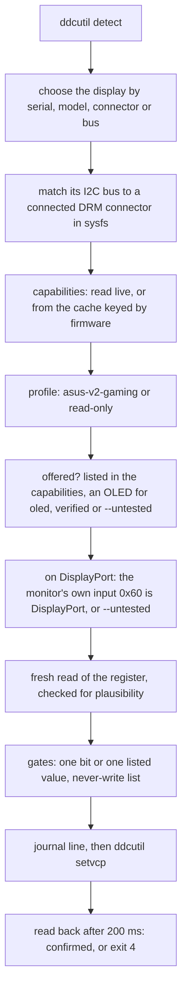

# How osdless works

The README covers using osdless. This page is the detail: what it needs, how it picks a monitor, what it
checks before a change, and what it reads and writes.

## Requirements in detail

- Linux with [ddcutil](https://www.ddcutil.com) 2.1 or later on `PATH`: osdless passes
  `--enable-cross-instance-locks`, which ddcutil 2.1.0 added. Only ddcutil 3.0.2 is tested.
- Read and write access to the monitor's `/dev/i2c-N`: the `i2c-dev` kernel module and the group or
  udev rule that ddcutil's
  [installation notes](https://www.ddcutil.com/i2c_permissions/) describe. If
  `ddcutil detect` works as your user, osdless does too. Nothing runs as root.
- DDC/CI turned on in the monitor's OSD (it usually is).
- Python 3.11 or later. With [uv](https://docs.astral.sh/uv/), nothing else to install.
- For `oled clean` only: `systemd-inhibit`, or KDE's `kde-inhibit` and `busctl`. For the journal
  lines of every write: `logger` (util-linux).

## Installing a copy you have read

osdless writes to your monitor's registers, so run a copy you have read rather than whatever `main`
holds at the moment. It is one file:

```bash
curl -fLO https://raw.githubusercontent.com/ovflowd/osdless/main/osdless.py
less osdless.py
python3 osdless.py status      # or: uv run osdless.py status
```

The README's examples call it `osdless`: `chmod +x osdless.py` and put it on your `PATH` under that
name, or write `python3 osdless.py` in their place.

Or pin the commit you read, and run it from the URL or install it as a tool:

```bash
uv run https://raw.githubusercontent.com/ovflowd/osdless/<commit>/osdless.py status
uv tool install git+https://github.com/ovflowd/osdless@<commit>
osdless status
```

`uv tool install git+https://github.com/ovflowd/osdless` without a commit installs the latest one.

## How it talks to the monitor

osdless runs `ddcutil` one call at a time and reads its output. DDC/CI is the I2C channel in the
display cable that MCCS (the VESA standard for monitor settings) runs over: each setting is a VCP
code, and a read returns a current and a maximum value of 16 bits each. Codes `0xE0` to `0xFF` are
left to the manufacturer, which is where ASUS keeps OLED care, power, KVM and the rest.
[protocol.md](protocol.md) has the codes and values osdless uses, and where each fact
comes from.



## Profiles

A profile decides how osdless decodes a monitor and whether it writes to it. It is chosen from the
monitor's own replies, never from a list of models. `features` (and `status --json`) list every
step, and for a read-only monitor `status` names the step that failed:

1. **EDID maker `AUS`**, from `ddcutil detect`.
2. **`0xEF` reads an ASUS support code**, the value ASUS's own software checks before it treats a
   monitor as supported.
3. **VCP table 2**, from the high byte of `0xEF`'s maximum. Older tables give `0xE1`, `0xF8` and
   `0xF9` other meanings: on them `0xF8` is the HDR mode.
4. **The ASUS gaming line**: the model starts with `PG`, `XG` or `VG`, as ROG and TUF Gaming models
   do. On ProArt and the other lines the bits of `0xFD` mean other things. Within the gaming line,
   the `oled` commands also need an OLED by ASUS's own naming rule, a `D` or `W` as the model's 7th
   character (INFERRED from ASUS's app); on any other model `features` gives that as the reason on
   each `oled` line.
5. **The capabilities name the same model** as the EDID.

All five give **`asus-v2-gaming`**, which writes the settings in the table above. Anything else gives
**`read-only`**, which decodes the standard MCCS codes, and the last line of the profile block in
`features` says which step failed.

## Safety model

- **One write path.** One function sends `setvcp`, and every check below runs in front of it. The
  read-only commands (`list`, `status`, `get`, `features`, `report`) run ddcutil through a runner that
  cannot send `setvcp` at all.
- **Only ddcutil's read commands and `setvcp`.** Each call passes `--noconfig`, `--disable-udf` and
  `--enable-cross-instance-locks`, so a ddcutil configuration file cannot switch off ddcutil's lock
  and user-defined features cannot change how a code is sent. Every call has a timeout and starts at
  least 50 ms after the previous one ended, and every call after `detect` names the bus with `--bus`.
- **Never sent, not even as a read:** `0x01` (degauss), `0x04`, `0x05`, `0x06`, `0x08` and `0x0A`
  (restore defaults), `0xB0` (store or restore settings), `0xEC` (ASUS mode reset), `0xFE` (ASUS
  firmware-update selector; it only times out), `0xDD` (answers with another code's data on the
  PG39WCDM), and `0xE8` (an ASUS move command) and `0xEB` (ASUS OSD key presses), which are
  commands, not settings.
- **Never written:** the codes above, plus `0x10` (the desktop owns brightness), `0xFC` (its low bits
  may be the power-key and key locks), `0xE2` and `0xC5` (the PC re-detects the display), `0xD6`
  (panel off), and `0xED`, `0x47` and `0xF2` (they mean different things on different product
  lines). Both lists are `NEVER_SEND` and `NEVER_WRITE` at the top of [osdless.py](../osdless.py).
- **No raw writes.** osdless writes the settings in the command table and nothing else: no `set`,
  no `--force`, no brightness, no resets.
- **Checked against the monitor's capabilities.** A code must be listed, a value must be in its list,
  and a bit must be inside the code's 16-bit mask. A refusal names what is listed.
- **The right monitor on the right bus.** The bus ddcutil reports must belong to a connected DRM
  connector in `/sys/class/drm`: on DisplayPort the connector's own DP-AUX adapter, on HDMI and DVI
  its `ddc` adapter. amdgpu also gives a DisplayPort connector a separate `ddc` adapter, which a
  passive DisplayPort-to-HDMI adapter uses; a monitor there is only read. So is a display on a bus
  that maps to no connector (the NVIDIA driver, MST hubs and docks can do this). `--untested MODEL`
  must name the chosen monitor, so an alias cannot carry it over to another one.
- **The monitor's own input.** A DisplayPort connector does not prove a DisplayPort link: an active
  adapter or a dock can put the monitor on HDMI. Before a write over DisplayPort, osdless reads
  `0x60`, and an HDMI or USB-C input, a failed read or a value it cannot place makes the write
  untested.
- **A fresh, plausible read before every write.** A failed read, the `0xFE`/`0xFE` "not available in
  this mode" marker, or a value that is implausible twice in a row stops the write. A bitfield reply
  is plausible only when its maximum equals the capabilities mask and no bit outside the mask is set;
  a value reply only when the value is in the capabilities list. Each write uses up its read, so a
  write never starts from an old one.
- **One bit at a time.** A toggle changes exactly its own bit and keeps the others. A value above
  `0xFF` is only sent to carry `0xFD`'s high byte through unchanged.
- **Read-back.** osdless reads the register 200 ms after a write. It sends a setting once more only
  when the read-back still shows the old value; any other read-back stops with exit 4. `kvm` and
  `input` are read back after 2 s and never sent twice, since the switch may still be in progress.
- **Pixel cleaning stays an action.** No `0xFD` write is sent while bit `0x10` reads set, and only
  `oled clean` sets it, so a toggle can never start a cleaning run.
- **One run at a time**, through a lock on `$XDG_RUNTIME_DIR/osdless.lock`, on top of ddcutil's own
  lock on `/dev/i2c-N`. Other ddcutil and libddcutil users, such as KDE's power manager, are
  expected to take that lock too.
- **A journal line before and after every write**, under `journalctl -t osdless`, so a run killed
  between the write and its read-back still leaves a trace.

## Pixel cleaning

`oled clean --yes` starts a manual pixel cleaning run. The screen is unavailable for about 6 to 8
minutes, and the run needs a live picture, so osdless:

- refuses within 20 hours of the last start. The guard covers every monitor, so with two OLEDs a run
  on one blocks the other. The time is kept in `$XDG_STATE_HOME/osdless/last-clean.json`.
- refuses unless `0xD6` reads 1 (the display is on) and `0xFD` bit `0x10` is clear.
- holds `systemd-inhibit --what=idle:sleep` and, on KDE, `kde-inhibit --power --screenSaver` for
  11 minutes, with or without `--wait`. kde-inhibit exits 0 even when its D-Bus calls fail, so it
  only counts once PowerDevil lists the new inhibitions. With neither one holding, osdless refuses.
- records the start before it sends anything, and never retries.
- with `--wait`, reads `0xFD` every 30 s until it shows exactly the value from before cleaning, and
  says when that was. The inhibitors still run their full 11 minutes, because no model is known yet
  to keep bit `0x10` set until its run ends. After 10 minutes of polling, osdless exits 3.

No cleaning run has been started through osdless yet. The KDE check was built against Plasma 6;
GNOME is untested.

## Choosing a monitor

`--serial`, `--model`, `--connector` and `--bus` combine: a monitor must match all of the ones you
give. With a single DDC/CI display and no selector, that display is used. When more than one display
matches, osdless refuses and lists them. A monitor that reports no serial number can still be read,
but writes need it chosen by `--connector` or `--bus`. To pin your monitor, use an alias:

```bash
alias osd='osdless --serial <your serial>'
```

## Output and exit codes

`--json` prints exactly one document. `status` gives `display`, `profile` (with the reasons for it),
`caps_source`, `vcp_table` and `codes`, with the raw `mh`/`ml`/`sh`/`sl` bytes, the decoded text and,
for bitfields, each bit of the mask. A write gives `{"command", "code", "old", "new", "written"}`;
`oled clean` adds `inhibitors` and `hold_seconds`, and with `--wait`, `finished_after_min`. A
failure, a command line osdless cannot parse included, gives
`{"ok": false, "exit": N, "error": "..."}` on stdout, with the message on stderr too.

| Exit code | Meaning |
|---|---|
| 0 | Done, or already so (nothing written) |
| 2 | Refused: a gate said no, or the command line was wrong |
| 3 | A read failed |
| 4 | A write was sent but the read-back did not confirm it |
| 130 | Interrupted |

## Privacy

- **Nothing goes over the network.** osdless talks to ddcutil, sysfs, a few local tools and your disk.
- **What it reads:** the monitor through ddcutil (`detect`, `capabilities`, `getvcp`), the DRM
  connectors under `/sys/class/drm`, and for `oled clean` PowerDevil's list of inhibitions through
  `busctl --user`.
- **What it writes:**
  - The capabilities cache, `$XDG_CACHE_HOME/osdless/caps-<maker>-<model>-<serial>-ff<firmware>-ef<0xEF>.json`,
    PG39WCDM only for now. It holds the serial number, so osdless creates its directory with mode
    `0700`; a directory that already exists keeps its mode.
  - `$XDG_STATE_HOME/osdless/last-clean.json`, the start of the last pixel cleaning run, in a
    directory created the same way.
  - The lock file `$XDG_RUNTIME_DIR/osdless.lock`, mode `0600`.
  - The report file, only where you run `report`. It leaves out the serial number.
- **What it logs:** each write's model, bus, connector, code, old and new value and read-back, to the
  journal through `logger -t osdless`. No serial number.
- **What it prints:** `list`, `status` and `features` print the serial number. Replace it before you
  paste their output into an issue, or use `report`, which leaves it out.

| Variable | Default | Effect |
|---|---|---|
| `XDG_CACHE_HOME` | `~/.cache` | Where the capabilities cache goes |
| `XDG_STATE_HOME` | `~/.local/state` | Where `last-clean.json` goes |
| `XDG_RUNTIME_DIR` | `/run/user/<uid>` | Where the lock goes |
| `OSDLESS_DDCUTIL` | `ddcutil` on `PATH` | The ddcutil binary to run |
| `OSDLESS_DRM_ROOT` | `/sys/class/drm` | Where to look for DRM connectors (for the tests) |
| `OSDLESS_NO_SYSLOG` | unset | `1` skips the journal lines (for the tests) |

## Limitations

- Tested on one monitor, one GPU driver (amdgpu), one connection (DisplayPort, direct) and one
  desktop (KDE Plasma 6). Every other model, HDMI, adapters and docks, other drivers and GNOME are
  untested. How i915 and xe lay out their DisplayPort buses comes from the kernel source only.
- Only one write is verified, and not yet through osdless itself (see
  [Supported monitors](supported-monitors.md)). 16-bit writes have never been sent to a real monitor.
- osdless writes only to ASUS gaming monitors on VCP table 2, and the `oled` settings only to the
  ones ASUS's naming rule marks as OLEDs. ProArt, other ASUS lines, older tables and other makers
  are only read, and for them osdless adds little over `ddcutil getvcp`.
- Capabilities are cached for the PG39WCDM only, whose `0xFF` is known to be the firmware version.
  Every other monitor's capabilities are read on each run, which takes a second or more.
- Some names are guesses: the order of the HDR modes in `0xE2` and the `0xFC` bits marked `(?)`.
  Bits of `0xFC` and `0xFD` without a name show as "unidentified". `0xFC` is never written. Gamma
  is decoded only in the low-byte form the PG39WCDM uses; the high-byte form some models use shows
  as unknown.
- Not supported on purpose: raw writes, brightness, resets, HDR and anti-flicker switches, OSD key
  presses, power off, firmware, lighting, and the monitor's USB HID interface, which also carries
  firmware-update commands.
- Linux only.
